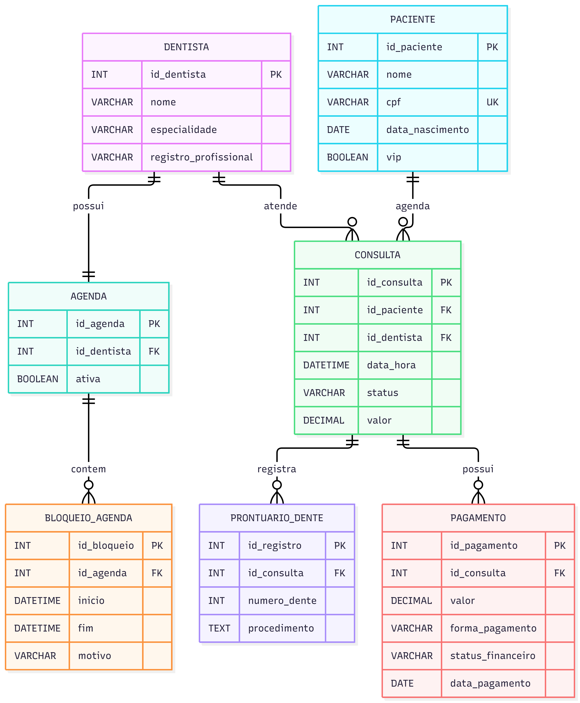

dentista Roberto,Ele quer um sistema para gerenciar os agendamentos de pacientes da clínica dele.

Sorriso Metálico — Modelagem do Banco de Dados Modelo Entidade-Relacionamento (MER) Entidades e atributos Paciente: armazena o nome, o CPF, a data de nascimento e a classificação VIP. Dentista: armazena o nome, a especialidade e o registro profissional. Agenda: representa a agenda individual de cada dentista. Bloqueio de Agenda: registra os horários indisponíveis e o motivo do bloqueio. Consulta: registra o paciente, o dentista responsável, a data, o horário, o status e o valor. Prontuário do Dente: registra o número do dente e a descrição do procedimento realizado. Pagamento: registra o valor, a forma de pagamento, a data e o status financeiro. Relacionamentos Cada dentista possui uma agenda individual (1:1). Uma agenda pode possuir vários bloqueios de horário (1:N). Um paciente pode realizar várias consultas (1:N). Um dentista pode atender várias consultas (1:N). Uma consulta pode possuir vários registros de procedimentos dentários (1:N). Uma consulta pode possuir vários registros de pagamento (1:N). Regras de negócio O cadastro exige nome e CPF, e pacientes menores de 18 anos não podem concluir o cadastro. Aos sábados pela manhã, somente pacientes VIP podem agendar consultas. O sistema deve impedir dois agendamentos no mesmo horário para o mesmo dentista. Cada dentista possui sua própria agenda e pode bloquear horários indisponíveis. O prontuário registra o procedimento realizado em cada dente. O status financeiro deve ser Pago ou Pendente. As formas de pagamento aceitas são PIX, cartão e dinheiro. A interface deve utilizar azul-marinho e prata, com aparência premium e profissional. Diagrama Entidade-Relacionamento (DER)

!Diagrama DER

## Diagrama DER

